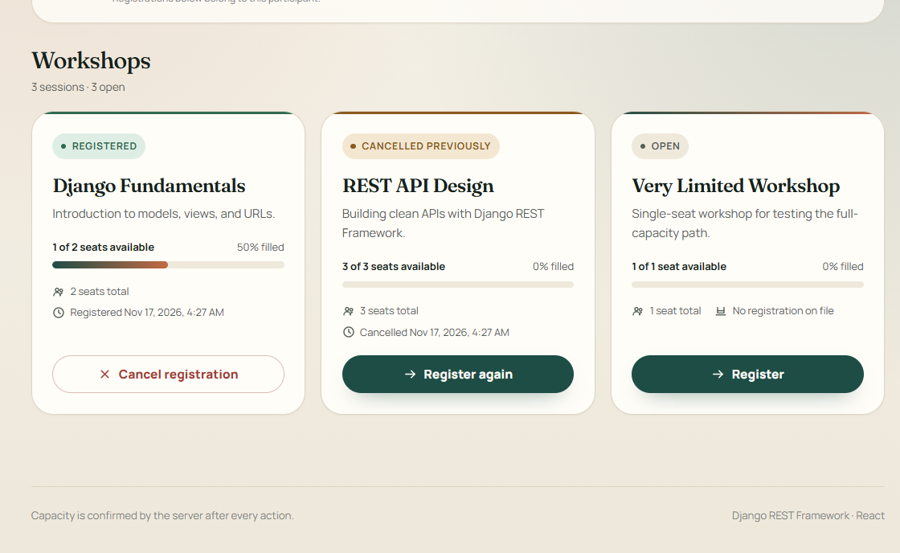
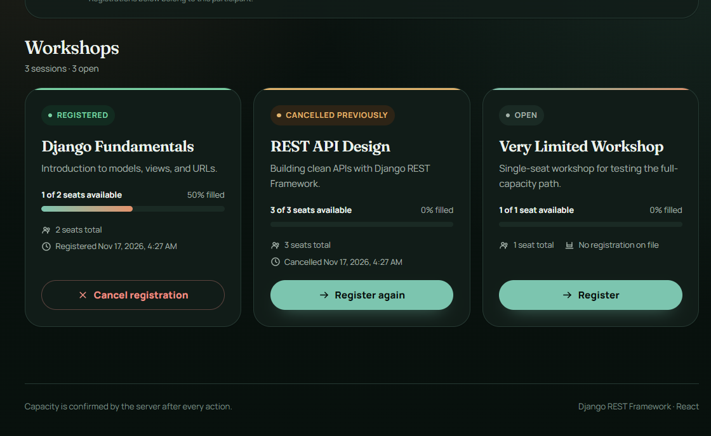
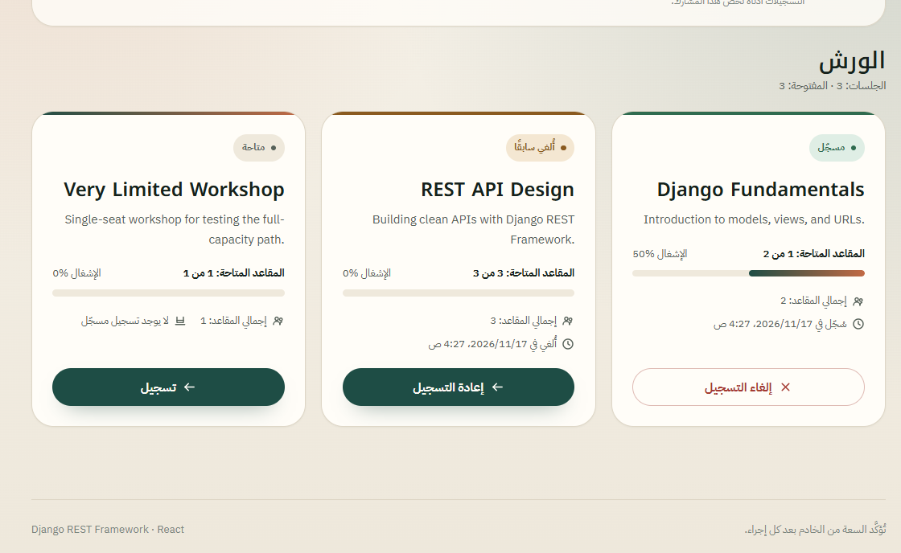
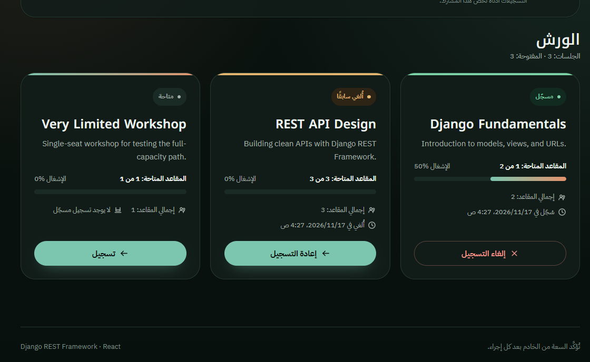
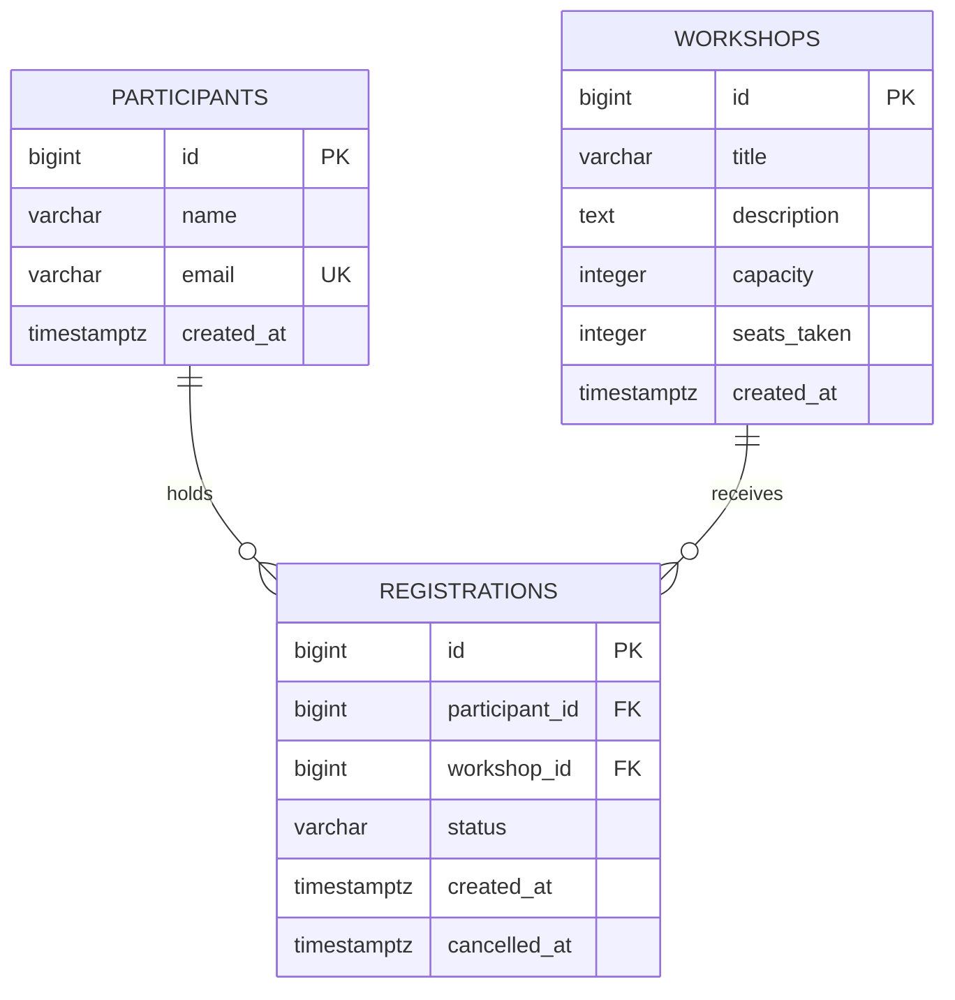
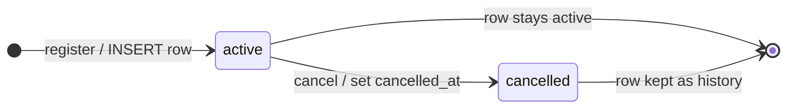

# Workshop Registration System

A small, production-minded workshop seat-reservation application. Participants can browse
workshops, see live seat availability, register, cancel a registration, and register again
later. The server is always the source of truth for capacity.

The repository contains two applications:

| Application | Location | Responsibility |
| --- | --- | --- |
| REST API | repository root | Django + Django REST Framework + PostgreSQL |
| Web client | `frontend/` | React + TypeScript + Vite |

The web client is bilingual (Arabic/English, including RTL) and supports light and dark
themes. The API is intentionally unauthenticated because authentication was outside the
scope of the exercise.

---

## Interface preview

The same workshop list in both languages and both themes. The screenshots were taken from
the running application after registering for one workshop and cancelling another, so all
three card states are visible: active registration, previously cancelled, and open.

| Light | Dark |
| --- | --- |
|  |  |
|  |  |

Workshop titles and descriptions are database content and are shown in English in both
languages; the interface around them — labels, states, dates, and formatting — is
translated.

---

## Contents

- [Interface preview](#interface-preview)
- [What is implemented](#what-is-implemented)
- [Technology stack](#technology-stack)
- [Prerequisites](#prerequisites)
- [Exact commands to run locally](#exact-commands-to-run-locally)
- [Configuration](#configuration)
- [API reference](#api-reference)
- [Business rules](#business-rules)
- [Data model and integrity](#data-model-and-integrity)
- [Transactions and concurrency](#transactions-and-concurrency)
- [Architecture](#architecture)
- [Frontend behaviour](#frontend-behaviour)
- [Tests](#tests)
- [Approximate time spent](#approximate-time-spent)
- [Assumptions and known limitations](#assumptions-and-known-limitations)
- [Short answers to the three README questions](#short-answers-to-the-three-readme-questions)
- [Troubleshooting](#troubleshooting)
- [Project structure](#project-structure)

---

## What is implemented

### Backend

- Three related models: `Participant`, `Workshop`, and `Registration`.
- A registration **history** model: cancelling updates `status` and `cancelled_at`; rows
  are never deleted.
- Database-enforced rules:
  - only one **active** registration per participant and workshop (partial unique index);
  - `0 <= seats_taken <= capacity`;
  - `capacity > 0`;
  - `cancelled_at` is set if and only if the registration is cancelled.
- Transactional registration and cancellation using `transaction.atomic()` and
  `select_for_update()`.
- API validation with clear `400`, `404`, `409`, and `500` responses.
- Seeded demo data through `python manage.py seed_data`.
- 16 automated tests covering the API, service rules, and transaction rollback.

### Frontend

- Live workshop list with capacity meters and per-workshop state.
- Registration, cancellation, and re-registration without a page reload.
- Loading skeletons, empty states, error states, and per-card feedback.
- Double-submit protection and disabled controls while a request is in flight.
- Arabic and English UI with correct `lang`/`dir` handling and RTL layout.
- Light and dark themes, with the choice persisted in `localStorage`.
- Responsive layout, keyboard-accessible controls, reduced-motion support.
- 20 automated tests covering domain rules, API error mapping, components, and page flow.

---

## Technology stack

| Layer | Technology |
| --- | --- |
| API framework | Django 5.2, Django REST Framework 3.16 |
| Database | PostgreSQL (required) |
| Local database (optional) | Docker Compose + PostgreSQL 16 |
| Python dependencies | `django-environ`, `django-cors-headers`, `psycopg2-binary` |
| Frontend runtime | React 19 |
| Build tool | Vite 8 |
| Language | TypeScript (strict) |
| Server state | TanStack Query 5 |
| Runtime validation | Zod 4 |
| Styling | CSS Modules + design tokens |
| Frontend tests | Vitest 5, Testing Library, jsdom |
| Linting | Oxlint |

PostgreSQL is not an arbitrary choice: the design relies on `select_for_update()` row
locking, which SQLite does not provide, and on a partial unique index created by Django's
`UniqueConstraint(condition=...)`. The concurrency guarantees documented below assume a
real PostgreSQL connection.

---

## Prerequisites

- **Python** 3.10 or newer.
- **PostgreSQL** 13 or newer, running locally or reachable over the network. Skip a local
  installation if you use the Docker option in step 2.
- **Docker** with the Compose plugin (optional, recommended): starts PostgreSQL with a
  single command.
- **Node.js** `^20.19.0` or `>=22.12.0` (the Vite 8 engine requirement).
- **npm** 10 or newer (bundled with the supported Node.js versions).
- `psql` or pgAdmin, only if you create the database without Docker.
- Git, if you are cloning the repository.

Verify the versions:

```bash
python --version
psql --version
node --version
npm --version
```

---

## Exact commands to run locally

The commands below assume the repository root is the current directory, except where a
step says otherwise.

### 1. Get the project

```bash
git clone https://github.com/AmeenAlslahy/workshop-registration.git
cd workshop-registration
```

If you received the project as an archive, extract it and open a terminal in the
`workshop-registration` directory instead.

### 2. Create the PostgreSQL database

Choose one of the two options below. Both create a database that matches `.env.example`,
and both allow Django to create the temporary test database that `manage.py test` needs.

#### Option A — Docker (recommended)

If Docker is installed, start PostgreSQL with a single command from the repository root:

```bash
docker compose up -d --wait
```

The compose file reads `DB_NAME`, `DB_USER`, `DB_PASSWORD`, and `DB_PORT` from the root
`.env` when it exists, and falls back to the same values as `.env.example` otherwise. The
container defines a health check, so `--wait` returns only after PostgreSQL accepts
connections. Data is stored in the named volume `postgres_data`, so it survives a container
restart.

If a local PostgreSQL instance is already using port 5432, stop it or set `DB_PORT=5433`
in `.env` before starting the container. Django reads the same variable, so both sides stay
aligned.

#### Option B — an existing PostgreSQL server

Open a superuser session:

```bash
psql -U postgres
```

On Windows, `psql` may not be on `PATH`. Use the full path from your PostgreSQL installation
or run the same SQL from pgAdmin's Query Tool.

Run:

```sql
CREATE ROLE workshop_user WITH LOGIN PASSWORD 'your-db-password' CREATEDB;
CREATE DATABASE workshop_db OWNER workshop_user;
\q
```

`CREATEDB` matters: `manage.py test` creates and drops a separate `test_workshop_db`
beside the development database, so a role without that privilege fails with
`permission denied to create database`. A role created by the Docker image is a superuser
and already has it.

If the role already exists without the privilege, grant it instead of recreating the role:

```sql
ALTER ROLE workshop_user CREATEDB;
```

If the role or database already exists, either reuse it and update `.env`, or drop and
recreate it. The values above match `.env.example`; you may choose different credentials.

### 3. Create and activate a Python virtual environment

**Windows PowerShell**

```powershell
python -m venv .venv
.\.venv\Scripts\Activate.ps1
```

If PowerShell blocks activation scripts, allow them for the current process only:

```powershell
Set-ExecutionPolicy -Scope Process -ExecutionPolicy Bypass
.\.venv\Scripts\Activate.ps1
```

**Windows Command Prompt**

```bat
python -m venv .venv
.venv\Scripts\activate.bat
```

**macOS / Linux**

```bash
python3 -m venv .venv
source .venv/bin/activate
```

Install the dependencies:

```bash
python -m pip install --upgrade pip
pip install -r requirements.txt
```

### 4. Create the environment file

**Windows PowerShell**

```powershell
Copy-Item .env.example .env
```

**macOS / Linux**

```bash
cp .env.example .env
```

Open `.env` and set at least `SECRET_KEY` and the database values. `SECRET_KEY` has no
default, so the application will not start until it is set. Generate a real value instead of
keeping the placeholder:

```bash
python -c "import secrets; print(secrets.token_urlsafe(50))"
```

`.env` is listed in `.gitignore`, so Git ignores it; only `.env.example`, which contains
placeholders, is tracked. Keep it that way: a database password or a Django secret key that
reaches a public repository must be treated as leaked and rotated.

### 5. Apply migrations and seed demo data

```bash
python manage.py migrate
python manage.py seed_data
```

`seed_data` is destructive: it deletes all registrations, workshops, and participants
before inserting the demo data. It prints the generated IDs, which may differ from the
examples in this README after a database has been reused.

### 6. Start the API

```bash
python manage.py runserver
```

The API is available at `http://127.0.0.1:8000/api/`.

### 7. Start the web client

Open a second terminal:

```bash
cd frontend
npm install
npm run dev
```

Open `http://127.0.0.1:5173`.

Vite proxies `/api` to `http://127.0.0.1:8000`, so the browser uses one origin during
development and no CORS preflight is required. The proxy target and API base path can be
changed in `frontend/.env`:

```bash
VITE_API_BASE_URL=/api
VITE_API_PROXY_TARGET=http://127.0.0.1:8000
```

### 8. Verify the setup (optional)

```bash
# API
curl http://127.0.0.1:8000/api/participants/
python manage.py check

# Frontend
cd frontend
npm run typecheck
npm run lint
npm test
npm run build
```

These are the same checks used before submitting changes. The frontend block starts with
`cd frontend`, so run it from the repository root. `npm run build` also proves that the
production bundle compiles.

---

## Configuration

### Backend environment variables

| Variable | Default | Purpose |
| --- | --- | --- |
| `DEBUG` | `False` | Enable Django debug mode locally. Keep `False` in production. |
| `SECRET_KEY` | — (required) | Django cryptographic signing key. |
| `ALLOWED_HOSTS` | `localhost,127.0.0.1` | Comma-separated host names accepted by Django. |
| `DB_NAME` | — (required) | PostgreSQL database name. |
| `DB_USER` | — (required) | PostgreSQL role. |
| `DB_PASSWORD` | — (required) | PostgreSQL password. |
| `DB_HOST` | — (required) | Database host, normally `localhost`. |
| `DB_PORT` | — (required) | Database port, normally `5432`. |
| `CORS_ALLOWED_ORIGINS` | empty | Comma-separated browser origins allowed to call the API directly. |

`localhost:5173` and `127.0.0.1:5173` are already present in `.env.example`. They are only
needed when the frontend calls the API cross-origin instead of using the Vite proxy.

### Secrets handling

- Settings read every secret from the environment (`django-environ`); nothing is hardcoded.
  `SECRET_KEY` is required and has no fallback, so a missing value fails at startup instead
  of silently using an insecure default.
- `.env`, `.env.*`, and `frontend/.env` are ignored; `.env.example` and
  `frontend/.env.example` hold placeholders only.
- `docker-compose.yml` interpolates `DB_PASSWORD` from `.env` and falls back to the
  `.env.example` placeholder, so no real credential is stored in a tracked file.
- The repository contains no tokens, private keys, or production credentials. If a real
  secret is ever committed, rotating it is mandatory; deleting the file in a later commit
  does not remove it from history.

### Frontend environment variables

Create `frontend/.env` only when the defaults do not fit:

| Variable | Default | Purpose |
| --- | --- | --- |
| `VITE_API_BASE_URL` | `/api` | API path or absolute URL used by the browser. |
| `VITE_API_PROXY_TARGET` | `http://127.0.0.1:8000` | Where Vite forwards `/api` in development and preview. |

Vite variables are read at build time. If you deploy the built assets, set
`VITE_API_BASE_URL` to the public API URL **before** running `npm run build`.

---

## API reference

Base path: `/api/`. All requests and responses are JSON. No authentication is required.

| Method | Endpoint | Request | Success | Common errors |
| --- | --- | --- | --- | --- |
| `GET` | `/participants/` | — | `200` list of participants | — |
| `GET` | `/workshops/?participant_id=<id>` | Query: `participant_id` | `200` list of workshops | `400` invalid/missing ID, `404` unknown participant |
| `POST` | `/workshops/<workshop_id>/register/` | `{"participant_id": <id>}` | `201` registration created | `400` invalid body, `404` unknown participant/workshop, `409` already registered or full |
| `POST` | `/registrations/<registration_id>/cancel/` | `{"participant_id": <id>}` | `200` registration cancelled | `400` invalid body, `404` registration not found for that participant, `409` already cancelled |

### `GET /api/participants/`

```json
[
  { "id": 1, "name": "Alice Johnson", "email": "alice@example.com" },
  { "id": 2, "name": "Bob Smith", "email": "bob@example.com" },
  { "id": 3, "name": "Carol Williams", "email": "carol@example.com" }
]
```

### `GET /api/workshops/?participant_id=1`

The response contains every workshop plus availability and this participant's most recent
registration:

```json
[
  {
    "id": 1,
    "title": "Django Fundamentals",
    "description": "Introduction to models, views, and URLs.",
    "capacity": 2,
    "seats_taken": 0,
    "available_seats": 2,
    "active_registration_id": null,
    "last_registration": null
  },
  {
    "id": 2,
    "title": "REST API Design",
    "description": "Building clean APIs with Django REST Framework.",
    "capacity": 3,
    "seats_taken": 1,
    "available_seats": 2,
    "active_registration_id": 1,
    "last_registration": {
      "id": 1,
      "status": "active",
      "created_at": "2026-11-16T19:36:00Z",
      "cancelled_at": null
    }
  }
]
```

`last_registration` is ordered by `created_at` descending. It is `null` if the participant
has never registered for that workshop. A cancelled registration is still returned, which
is what lets the UI show "Cancelled previously" and offer "Register again".

### `POST /api/workshops/<workshop_id>/register/`

```bash
curl -X POST http://127.0.0.1:8000/api/workshops/1/register/ \
  -H "Content-Type: application/json" \
  -d "{\"participant_id\": 1}"
```

```json
{
  "message": "Registration successful",
  "registration_id": 1
}
```

### `POST /api/registrations/<registration_id>/cancel/`

```bash
curl -X POST http://127.0.0.1:8000/api/registrations/1/cancel/ \
  -H "Content-Type: application/json" \
  -d "{\"participant_id\": 1}"
```

```json
{
  "message": "Registration cancelled"
}
```

### Error contract

Validation errors follow DRF's field-error shape:

```json
{ "participant_id": ["Ensure this value is greater than or equal to 1."] }
```

Business errors use a single `error` key:

```json
{ "error": "Workshop is full." }
```

| Status | Meaning in this API |
| --- | --- |
| `400` | Missing, non-numeric, or out-of-range `participant_id`; malformed body. |
| `404` | Participant, workshop, or registration does not exist (or does not belong to that participant). |
| `409` | The request conflicts with current state: already registered, workshop full, or already cancelled. |
| `500` | Unexpected server error. The transaction is rolled back. |

The `curl` examples use bash syntax. On Windows, use `curl.exe` from PowerShell or run them
in Git Bash; PowerShell's `curl` alias points to `Invoke-WebRequest` and does not accept the
same flags.

---

## Business rules

1. **One active registration per participant and workshop.** Enforced by the service and
   by a partial unique index in PostgreSQL.
2. **Cancellation preserves history.** The row remains with `status = 'cancelled'` and a
   `cancelled_at` timestamp.
3. **Re-registration is allowed.** After cancelling, the participant can register again,
   any number of times. Each cycle creates a new row.
4. **Capacity is authoritative.** A registration is only accepted when
   `seats_taken < capacity` inside the locked transaction.
5. **Seat accounting is atomic.** The seat count is incremented and decremented in the same
   transaction as the registration change.
6. **Cancellation is ownership-checked.** The registration must belong to the supplied
   `participant_id`; otherwise the API returns `404`.

`seats_taken` is a denormalised counter. It is kept because the workshop list needs live
availability without aggregating registrations on every request. The counter is protected
by the service transaction and by a `CHECK` constraint.

---

## Data model and integrity

### ERD



One participant takes part in zero or more registrations, and one workshop receives zero or
more registrations. `REGISTRATIONS` is a rich through-model: it is the only place where
`status`, `created_at`, and `cancelled_at` live, which is exactly the history the interface
needs.

Both foreign keys use `on_delete=PROTECT`, so a participant or workshop with registration
history cannot be deleted by accident. The arrows are `||--o{` because a registration cannot
exist without both parents.

### Physical schema

The same model as PostgreSQL stores it, with the constraint names that `models.py` defines:

| Table | Column | Type | Null | Default | Key / constraint |
| --- | --- | --- | --- | --- | --- |
| `participants` | `id` | `bigint` | no | identity | primary key |
| `participants` | `name` | `varchar(100)` | no | — | |
| `participants` | `email` | `varchar(254)` | no | — | unique |
| `participants` | `created_at` | `timestamptz` | no | `auto_now_add` | |
| `workshops` | `id` | `bigint` | no | identity | primary key |
| `workshops` | `title` | `varchar(200)` | no | — | |
| `workshops` | `description` | `text` | no | `''` | |
| `workshops` | `capacity` | `integer` | no | — | `workshop_capacity_positive`: `capacity > 0` |
| `workshops` | `seats_taken` | `integer` | no | `0` | `workshop_seats_within_capacity`: `0 <= seats_taken <= capacity` |
| `workshops` | `created_at` | `timestamptz` | no | `auto_now_add` | |
| `registrations` | `id` | `bigint` | no | identity | primary key |
| `registrations` | `participant_id` | `bigint` | no | — | foreign key → `participants.id` (`PROTECT`), indexed |
| `registrations` | `workshop_id` | `bigint` | no | — | foreign key → `workshops.id` (`PROTECT`), indexed |
| `registrations` | `status` | `varchar(10)` | no | `'active'` | `active` / `cancelled`, enforced by `choices` and the API, not by a `CHECK` |
| `registrations` | `created_at` | `timestamptz` | no | `auto_now_add` | |
| `registrations` | `cancelled_at` | `timestamptz` | yes | `NULL` | `registration_cancelled_at_consistent` |

`timestamptz` is PostgreSQL's `timestamp with time zone`. `USE_TZ` is `True` and `TIME_ZONE`
is `UTC`, so every timestamp is stored in UTC and localised by the client. The `Default`
column shows the Django-side value applied on insert (`auto_now_add` is set in Python); only
the `id` columns have a database default, because they are identity columns.

### Constraints and indexes

| Name | Table | Definition |
| --- | --- | --- |
| `participants_pkey` | `participants` | `PRIMARY KEY (id)` |
| unique on `email` | `participants` | `UNIQUE (email)` |
| `workshops_pkey` | `workshops` | `PRIMARY KEY (id)` |
| `workshop_capacity_positive` | `workshops` | `CHECK (capacity > 0)` |
| `workshop_seats_within_capacity` | `workshops` | `CHECK (seats_taken >= 0 AND seats_taken <= capacity)` |
| `registrations_pkey` | `registrations` | `PRIMARY KEY (id)` |
| foreign-key index | `registrations` | `(participant_id)` — used by "my registrations" lookups |
| foreign-key index | `registrations` | `(workshop_id)` — used by per-workshop queries |
| `unique_active_registration_per_workshop` | `registrations` | `UNIQUE (participant_id, workshop_id) WHERE status = 'active'` |
| `registration_cancelled_at_consistent` | `registrations` | `CHECK ((status = 'active' AND cancelled_at IS NULL) OR (status = 'cancelled' AND cancelled_at IS NOT NULL))` |

The four `Meta.constraints` names are written by hand in `models.py`, so they are stable and
appear verbatim in database errors. Primary keys follow PostgreSQL's `<table>_pkey`
convention; Django adds a digest suffix to the unique constraint and the foreign-key indexes
(`participants_email_<digest>_uniq`), so they are listed here by definition instead of by a
guessed name.

One gap is deliberate: the database constrains how `status` and `cancelled_at` relate to each
other, but not the set of allowed `status` strings — `choices` is validated by the serializer
only. A `CHECK (status IN ('active', 'cancelled'))` would close that gap and is a cheap
hardening step for a production version.

### Registration lifecycle



The cancelled row is kept forever. Registering again after a cancellation inserts a **new**
`active` row, which is why the partial index filters on `status = 'active'` instead of
covering every row of the pair.

### The partial unique index

```python
UniqueConstraint(
    fields=["participant", "workshop"],
    condition=Q(status="active"),
    name="unique_active_registration_per_workshop",
)
```

On PostgreSQL this becomes a partial unique index. Cancelled rows are excluded, so:

- two simultaneous active registrations for the same pair are impossible;
- any number of cancelled rows is allowed;
- re-registration works after cancellation.

A plain `UNIQUE(participant_id, workshop_id)` would be incorrect because it would forbid
ever registering for that workshop again.

---

## Transactions and concurrency

`ATOMIC_REQUESTS` is `False`. Transactions are opened explicitly in
`apps/workshops/services.py` around the smallest unit of work that must be consistent.

### Register

```text
BEGIN
  SELECT ... FROM workshops WHERE id = ? FOR UPDATE;
  reject if an active registration already exists;
  reject if seats_taken >= capacity;
  seats_taken = seats_taken + 1;
  INSERT registration (status = 'active');
COMMIT
```

The workshop row is locked first. Concurrent requests for the same workshop are therefore
serialised: the second request waits for the first transaction to commit, then reads the
new `seats_taken`.

### Cancel

```text
BEGIN
  read the registration's workshop_id for the given participant;
  SELECT ... FROM workshops WHERE id = ? FOR UPDATE;
  SELECT ... FROM registrations WHERE id = ? FOR UPDATE;
  reject if already cancelled;
  UPDATE registration SET status = 'cancelled', cancelled_at = now();
  UPDATE workshops SET seats_taken = seats_taken - 1;
COMMIT
```

Both operations lock the workshop before the registration. Using the same lock order
reduces the chance of deadlocks between a registration and a cancellation on the same
workshop.

### The last-seat race

Two participants request the final seat at the same time:

1. Request A locks the workshop row and reads `seats_taken = capacity - 1`.
2. Request B blocks on the same row.
3. A increments the counter, inserts its registration, and commits.
4. B acquires the lock, reads `seats_taken = capacity`, and raises
   `WorkshopFullError`, which the view maps to `409 Conflict`.

The `workshop_seats_within_capacity` check constraint is a final safety net: even if a
future code path forgot the service rule, PostgreSQL would reject a counter above capacity.

### Rollback

Registration and cancellation run inside `transaction.atomic()`. If the registration
insert fails, the seat increment is rolled back with it. `RollbackTests` verifies this with
a real `TransactionTestCase` that forces `Registration.objects.create` to fail and then
asserts that `seats_taken` is still `0` and no registration exists.

Cancellation has a second consistency check: if `seats_taken` is already `0` while an
active registration exists, the update would affect zero rows, and the service raises
`DataInconsistencyError`. Because the transaction is atomic, the registration is not
marked cancelled. This is covered by
`test_cancel_rollback_when_seat_accounting_is_inconsistent`.

---

## Architecture

### Backend layers

| Layer | Location | Responsibility |
| --- | --- | --- |
| HTTP | `apps/*/views.py`, `apps/workshops/urls.py` | Parse requests, validate input, map domain errors to HTTP status codes. |
| Serialisation | `apps/workshops/serializers.py` | Validate `participant_id`, shape workshop responses, expose availability and history. |
| Domain services | `apps/workshops/services.py` | Transactions, locking, capacity rules, registration lifecycle. |
| Models | `apps/*/models.py` | Persistent shape and database constraints. |
| Tests | `apps/workshops/tests/` | API contract, service rules, rollback behaviour. |

Views do not contain business rules, and services do not know about HTTP. This keeps the
concurrency logic testable without going through the API and keeps the API contract easy
to change.

### Frontend layers

The frontend follows a strict dependency rule: a layer may depend on the layers below it,
never on the layers above it. `domain` has no React or transport knowledge.

```text
src/
├── app/             composition root, providers, error boundary, query client
├── domain/          pure types and registration-lifecycle rules
├── infrastructure/  endpoints, fetch client, Zod schemas, DTO mappers, API modules
├── application/     TanStack Query queries/mutations and cache invalidation
├── presentation/    layout, page, features, design-system components, i18n, theme
├── shared/          generic hooks and utilities
└── styles/          design tokens and global CSS
```

Data flow for a read:

```text
Page
  → application query hook
    → infrastructure API module
      → httpClient (fetch + 12 s timeout + abort)
      → Zod validation
      → snake_case DTO → camelCase domain model
  → domain rule (getWorkshopViewState)
  → presentation components
```

A mutation follows the same path in reverse. On success it invalidates the workshop query,
so capacity and history are fetched from the server instead of being guessed in the client.

The full frontend architecture, i18n/RTL details, theme implementation, and trade-offs are
documented in [`frontend/README.md`](frontend/README.md).

---

## Frontend behaviour

- **No optimistic updates.** A seat is only shown as reserved after the server confirms
  it. This is slower by a few hundred milliseconds and avoids showing capacity that the
  database rejected.
- **Per-card state.** `getWorkshopViewState` converts server data into `available`,
  `registered`, `cancelled`, or `full`, and decides which action is allowed. Labels are
  owned by the presentation layer, so the same rule works in both languages.
- **Request safety.** While a mutation is pending, all registration/cancellation buttons
  and the participant selector are disabled, preventing duplicate submissions.
- **Conflict recovery.** A `409` or `404` triggers a refetch, so stale availability is
  corrected immediately.
- **Real states, not blank screens.** Loading skeletons, empty-state guidance, inline
  refresh errors, and per-card success/error notices are implemented.
- **Accessibility.** Semantic headings, labelled controls, `aria-live` notices,
  `progressbar` values, visible focus styles, and reduced-motion support.
- **Bilingual and bidirectional.** Arabic and English copy live in one typed dictionary.
  The selected locale updates `<html lang>` and `<html dir>`; the choice is persisted.
- **Themes.** Light and dark tokens share the same component CSS. The selected theme is
  persisted and defaults to the operating-system preference.

---

## Tests

### Backend — 16 tests

```bash
python manage.py test apps.workshops.tests
```

| File | Coverage |
| --- | --- |
| `apps/workshops/tests/test_api.py` | Missing/invalid/unknown participant IDs, listing, successful registration, duplicate registration, full workshop, cancellation, repeat cancellation. |
| `apps/workshops/tests/test_services.py` | Duplicate active registration, repeated register/cancel cycles, repeated cancellation, full capacity, inconsistent seat accounting. |
| `apps/workshops/tests/test_services.py::RollbackTests` | Real database rollback when registration creation fails. |

The last group uses `TransactionTestCase` because `TestCase` wraps each test in a
transaction and would hide a real rollback.

### Frontend — 20 tests

```bash
cd frontend
npm test
```

| File | Tests |
| --- | --- |
| `src/domain/workshopState.test.ts` | 5 |
| `src/infrastructure/api/errorMapper.test.ts` | 4 |
| `src/presentation/features/participants/ParticipantSelector.test.tsx` | 2 |
| `src/presentation/features/workshops/WorkshopCard.test.tsx` | 5 |
| `src/presentation/layout/AppShell.test.tsx` | 2 |
| `src/presentation/pages/WorkshopRegistrationPage.test.tsx` | 2 |

The page test mocks `fetch` with the **raw snake_case payloads Django returns**, so the Zod
validation and DTO mapping layers stay under test instead of being bypassed by pre-mapped
fixtures. `AppShell.test.tsx` exercises the language toggle (including `dir="rtl"`), the
theme toggle, and persistence in `localStorage`.

### Full verification

```bash
# Backend
python manage.py check
python manage.py test apps.workshops.tests

# Frontend
cd frontend
npm run typecheck
npm run lint
npm test
npm run build
```

What is **not** covered automatically:

- a true multi-connection concurrency test against PostgreSQL (the service tests verify
  the transaction logic, but do not launch parallel database sessions);
- browser end-to-end tests (Playwright/Cypress);
- visual regression tests.

The concurrency reasoning is documented above and enforced by row locks and database
constraints; adding a parallel-session test would be the next step for a production system.

---

## Approximate time spent

| Phase | Work | Time |
| --- | --- | --- |
| Learning | React 19, hooks, TanStack Query, Zod, Vitest and Testing Library | 7 h |
| Analysis | Requirements, data model, constraints, API contract, UI states | 3 h |
| Implementation | Backend models, services, validation | 5 h |
| Implementation | Frontend architecture and API integration | 4 h |
| Implementation | Bilingual UI, RTL, light/dark themes, responsive polish | 1 h |
| Implementation | Automated tests: 16 backend + 20 frontend | 2 h |
| Verification | Docker setup, documentation, final checks | 2 h |
| **Total** | | **24 h** |

Split: **7 hours learning the stack**, **3 hours of analysis**, **12 hours of
implementation**, and **2 hours of verification and documentation**.

This was my first project with React 19 and TanStack Query, so the learning time is counted
here instead of being hidden. AI assistance was used for scaffolding and review; its effect
is already reflected in the hours above rather than added on top of them.

The verification block includes `python manage.py test` (16 tests), `npm test` (20 tests),
`npm run typecheck`, `npm run lint`, `npm run build`, and the screenshot pass.

---

## Assumptions and known limitations

**No authentication.** Authentication was outside the stated scope. The API trusts the
`participant_id` supplied by the client, and the frontend lets the user pick a seeded
participant. In a real deployment this would be replaced by authenticated identity, and
the participant ID would come from the session or token rather than the request body.

**Sequential integer IDs.** The project uses `BigAutoField`. Sequential IDs are simple and
readable for a demo, but in a public production API they can enable IDOR-style enumeration.
UUIDs or opaque public IDs would be preferable.

**No pagination.** The workshop list is small and returned in full. A production version
would add pagination or cursor-based loading.

**No rate limiting.** Out of scope. In production this belongs at the reverse proxy or via
`django-ratelimit`.

**No deployment configuration.** The repository documents local development. A production
deployment still needs a WSGI/ASGI server, static file serving, TLS, secret management,
backup strategy, and a reverse proxy. `DEBUG` must be `False`.

**Workshop content is stored in one language.** The interface shell is fully bilingual, but
workshop titles and descriptions come from the database and are currently English. The
data model does not include translated content. A production version would add translated
fields or a translations table.

**Fonts are loaded from Google Fonts.** The UI uses Manrope and Fraunces for Latin text and
IBM Plex Sans Arabic and Noto Kufi Arabic for Arabic text. If the machine is offline, the
browser falls back to the system fonts; layout still works, but the typography changes.

**`seed_data` is destructive.** It deletes registrations, workshops, and participants
before seeding. Do not run it against data you want to keep.

**Theme and locale are stored per browser.** They persist in `localStorage`; they are not
synced across devices or users.

---

## Short answers to the three README questions

### 1. Schema

I modelled three tables: `Participant`, `Workshop`, and `Registration`.

`Registration` is a rich through-model rather than a simple join table. It carries
`status` (`active` / `cancelled`), `created_at`, and `cancelled_at`, so the full history is
preserved. Cancelling never deletes a row; it flips the status and records the timestamp.
That is what allows the UI to show "Cancelled previously" and still offer re-registration.

The key constraint is a **partial unique index** on `(participant_id, workshop_id)` with
`WHERE status = 'active'`. It guarantees at most one active registration per pair while
allowing any number of cancelled rows. A plain unique constraint would incorrectly forbid
re-registration after cancellation.

Capacity is stored as `seats_taken` with a `CHECK (0 <= seats_taken <= capacity)`
constraint, plus `CHECK (capacity > 0)`. A separate check enforces the consistency of
`status` and `cancelled_at`: an active row must have `cancelled_at = NULL`, and a cancelled
row must have it set.

### 2. Transactions

**Registration** runs in one `transaction.atomic()` block:

1. `SELECT ... FOR UPDATE` on the workshop row.
2. Reject an existing active registration for that participant/workshop.
3. Reject if `seats_taken >= capacity`.
4. Increment `seats_taken`.
5. Insert the `Registration` row.

**Cancellation** also runs in one atomic block:

1. Read the registration's `workshop_id` (scoped to the participant).
2. Lock the workshop row with `SELECT ... FOR UPDATE`.
3. Lock the registration row with `SELECT ... FOR UPDATE`.
4. Reject if it is already cancelled.
5. Set `status = 'cancelled'` and `cancelled_at = now()`.
6. Decrement `seats_taken`, failing if no row was updated.

**Overlapping requests for the final seat:** the workshop row lock serialises them. The
first request holds the lock, updates the counter, and commits. The second request waits,
then reads the committed value, sees that the workshop is full, and raises
`WorkshopFullError`, which the API returns as `409 Conflict`. The check constraint
`seats_taken <= capacity` is the final safety net.

The explicit transaction boundary is important because `ATOMIC_REQUESTS` is disabled. The
service decides exactly what must commit or roll back together.

### 3. AI and verification

**The incorrect AI suggestion:** an AI assistant initially suggested a standard
`UNIQUE(participant_id, workshop_id)` constraint to prevent duplicate registrations.

**Why it was wrong:** it would prevent a participant from ever registering for the same
workshop again, even after cancelling. That directly violates the requirement that
cancellation preserves history and that re-registration is allowed. The constraint solves
the duplicate-active problem by over-restricting the entire history.

**The fix:** a partial unique index using Django's
`UniqueConstraint(fields=["participant", "workshop"], condition=Q(status="active"))`. Only
active rows participate in the uniqueness check; cancelled rows are excluded.

**How I verified it:** `test_register_again_after_cancellation_cycles` registers, cancels,
registers again, cancels again, and registers a third time. It asserts that three rows
exist, exactly one is active, two are cancelled, and `seats_taken` is `1`. This proves both
halves of the requirement: duplicates are blocked while a registration is active, and
re-registration succeeds after cancellation. The database constraint is also visible in
the migration, so the guarantee does not depend on application code alone.

**How AI was used overall:** as a pair reviewer, not as an autopilot. It was useful for
scaffolding ideas, for challenging the design (which is how the wrong constraint above
surfaced), and for tightening documentation. Every suggestion was accepted only after I
could explain why it was correct, and the final state of the code is verified by the test
suite, `python manage.py check`, `npm run typecheck`, `npm run lint`, and a production
build. Suggestions that did not survive that check were discarded.

---

## Troubleshooting

### `django.db.utils.OperationalError: connection refused`

PostgreSQL is not running, or `DB_HOST`/`DB_PORT` in `.env` are wrong. Start PostgreSQL and
verify:

```bash
psql -U workshop_user -d workshop_db -h localhost -p 5432
```

### `password authentication failed for user "workshop_user"`

The role password and `DB_PASSWORD` do not match. Reset it:

```sql
ALTER ROLE workshop_user WITH PASSWORD 'your-db-password';
```

If you use Docker and changed `DB_PASSWORD` after the first start, PostgreSQL still has the
old password: it is applied only when the data directory is initialised. Recreate the
volume with `docker compose down -v` and start again. That deletes the data in the volume.

### Tests fail with `permission denied to create database`

`manage.py test` creates a temporary `test_workshop_db`, so the role needs `CREATEDB`:

```sql
ALTER ROLE workshop_user CREATEDB;
```

Roles created by the Docker image are superusers and do not need this step.

### `docker compose up -d` fails because port 5432 is already allocated

A local PostgreSQL service is already using the port. Stop it, or set `DB_PORT=5433` in
`.env` and run the command again. Django reads the same variable, so the API and the
container stay aligned.

### `psycopg2` installation fails on Windows

`requirements.txt` uses `psycopg2-binary`, which ships pre-built wheels. Make sure you are
installing into the active virtual environment and that Python is 3.10+.

### `That port is already in use` (8000 or 5173)

Stop the process using the port, or run Django on another port:

```bash
python manage.py runserver 8001
```

Then set `VITE_API_PROXY_TARGET=http://127.0.0.1:8001` in `frontend/.env` and restart
Vite.

### The frontend shows "Cannot reach the workshop service"

The API is not running, or the proxy target is wrong. Check
`http://127.0.0.1:8000/api/participants/` in the browser and confirm the Vite terminal is
still running.

### CORS error when calling the API directly

Add the frontend origin to `CORS_ALLOWED_ORIGINS` in `.env` and restart Django. With the
Vite proxy, CORS is not involved.

### The demo data is in an unexpected state

Re-seed:

```bash
python manage.py seed_data
```

This deletes existing registrations, workshops, and participants.

### `npm install` warns about the Node.js version

Use Node.js `^20.19.0` or `>=22.12.0`. Older versions are not supported by Vite 8.

### Arabic text looks disconnected or the layout is wrong

The Arabic UI requires the Arabic font files from Google Fonts. Check the browser Network
panel for blocked font requests. If the machine is offline, the fallback fonts are used;
this is expected and does not affect functionality.

---

## Project structure

```text
workshop-registration/
├── apps/
│   ├── participants/
│   │   ├── models.py            Participant model
│   │   ├── views.py             GET /api/participants/
│   │   └── urls.py
│   └── workshops/
│       ├── models.py            Workshop + Registration models and constraints
│       ├── services.py          atomic register/cancel business rules
│       ├── serializers.py       request validation + response shaping
│       ├── views.py             API endpoints and error mapping
│       ├── exceptions.py        domain exceptions
│       ├── urls.py
│       ├── migrations/
│       ├── management/commands/seed_data.py
│       └── tests/
│           ├── test_api.py
│           └── test_services.py
├── config/
│   ├── settings.py              Django settings, database, CORS, DRF
│   └── urls.py                  /api/ and /admin/ routing
├── docs/
│   └── screenshots/             interface screenshots used by this README
├── frontend/
│   ├── src/
│   │   ├── app/                 providers, error boundary, query client
│   │   ├── domain/              pure types and lifecycle rules
│   │   ├── infrastructure/      endpoints, HTTP client, Zod schemas, DTO mappers
│   │   ├── application/         TanStack Query hooks and mutations
│   │   ├── presentation/        layout, pages, features, components, i18n, theme
│   │   ├── shared/              generic hooks and utilities
│   │   └── styles/              tokens.css + global.css
│   ├── README.md                frontend architecture and trade-offs
│   ├── package.json
│   └── vite.config.ts
├── docker-compose.yml           optional local PostgreSQL (PostgreSQL 16)
├── .env.example
├── .gitignore
├── manage.py
├── requirements.txt
└── README.md
```
