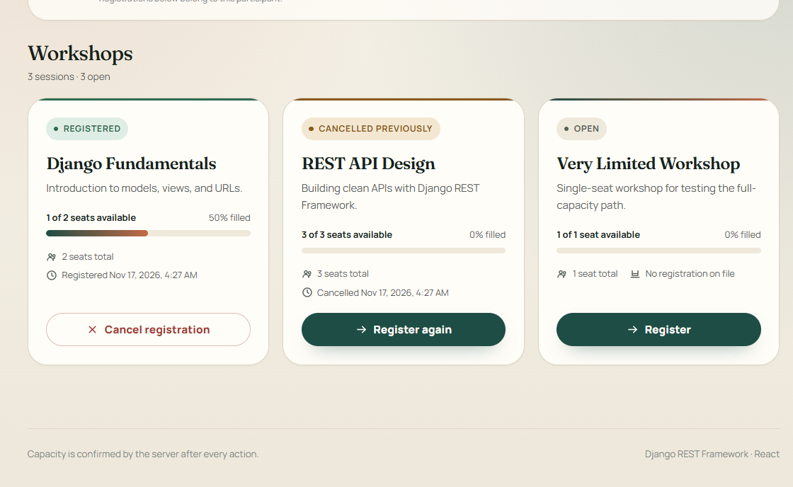
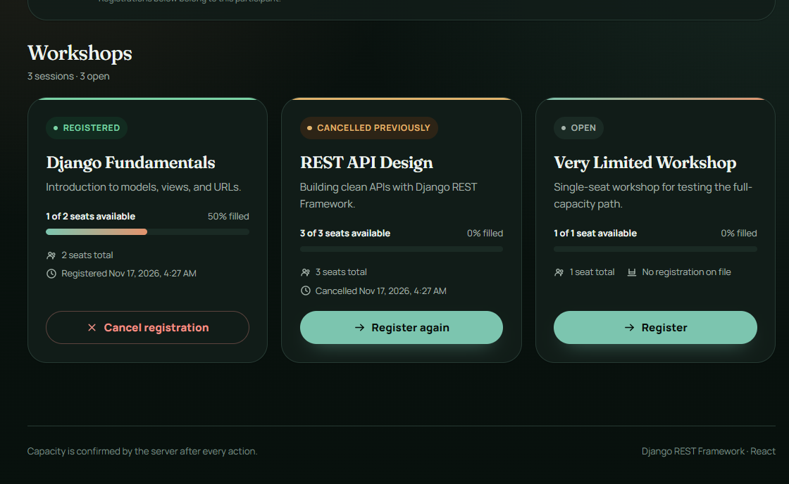
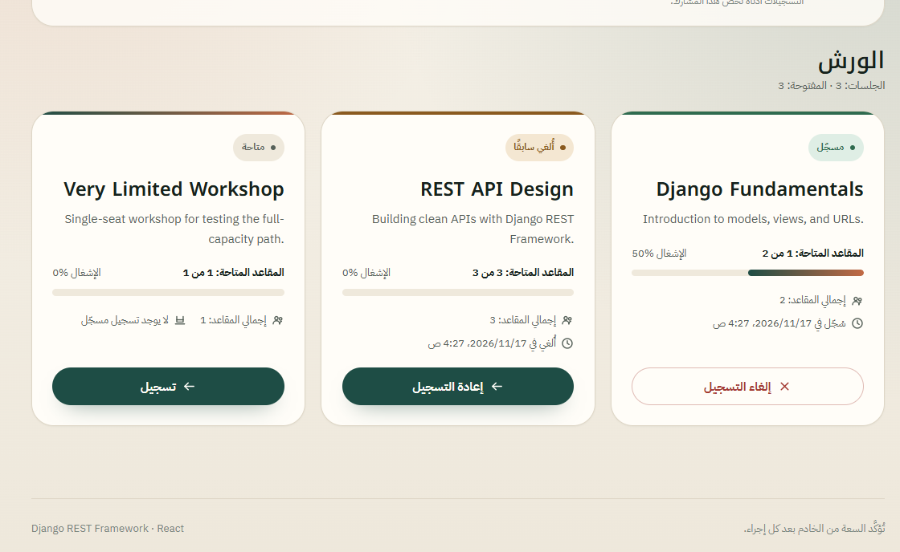
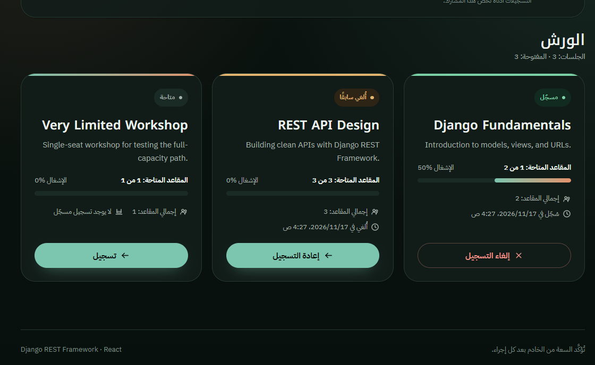

# Workshop Studio — Frontend

React + TypeScript client for the Django workshop-registration API. It lets a participant
browse workshops, see live seat availability, register, cancel, and register again while
keeping the server as the single source of truth.

The interface is fully bilingual (Arabic/English, including RTL) and ships with light and
dark themes. UI copy is translated; workshop titles and descriptions are content from the
database and are shown in the language in which they were entered.

---

## Interface preview

The workshop list in both languages and both themes, captured from the running application.
The demo data shows the three card states at once: an active registration, a previously
cancelled registration, and an open workshop.

| Light | Dark |
| --- | --- |
|  |  |
|  |  |

The images are stored in `../docs/screenshots/`, outside `frontend/`, and are shared with
the root README so both documents stay consistent. Workshop titles and descriptions are
database content, which is why they remain in English in the Arabic screenshots.

---

## Features

- Live workshop list with capacity meters and per-workshop state.
- Register, cancel, and re-register without a page reload.
- Per-card success and error notices.
- Loading skeletons, empty states, error states, and inline refresh errors.
- Double-submit protection: controls are disabled while a mutation is pending.
- Conflict recovery: `409` and `404` responses trigger a refetch.
- Arabic and English interface with correct `lang`/`dir` handling and RTL layout.
- Light and dark themes, persisted in `localStorage`.
- Responsive layout from mobile to wide desktop.
- Keyboard-accessible controls, labelled progress bars, `aria-live` notices, visible focus
  styles, and reduced-motion support.

---

## Stack

| Concern | Choice |
| --- | --- |
| UI runtime | React 19 |
| Build tool | Vite 8 |
| Language | TypeScript (strict) |
| Server state | TanStack Query 5 |
| Runtime validation | Zod 4 |
| Styling | CSS Modules + design tokens |
| Tests | Vitest 5 + Testing Library + jsdom |
| Linting | Oxlint |
| Fonts | Manrope + Fraunces (Latin), IBM Plex Sans Arabic + Noto Kufi Arabic (Arabic) |

---

## Requirements

- Node.js `^20.19.0` or `>=22.12.0` (the Vite 8 engine requirement).
- npm 10 or newer.
- The Django API running at `http://127.0.0.1:8000`, or a target you configure.

---

## Run it

```bash
cd frontend
npm install
npm run dev
```

Open `http://127.0.0.1:5173`.

Vite proxies `/api` to `http://127.0.0.1:8000`, so the browser talks to the same origin in
development and no CORS request is made. To point at another backend, create
`frontend/.env`:

```bash
VITE_API_BASE_URL=/api
VITE_API_PROXY_TARGET=http://127.0.0.1:8001
```

If you prefer to call the API directly instead of through the proxy:

```bash
# frontend/.env
VITE_API_BASE_URL=http://127.0.0.1:8000/api
```

In that case the origin must be present in Django's `CORS_ALLOWED_ORIGINS`.

Start and seed the backend first:

```bash
# from the repository root
python manage.py migrate
python manage.py seed_data
python manage.py runserver
```

The seed command prints the participant and workshop IDs. The UI also fetches the
participant list, so you can switch participants from the selector without editing code.

---

## Commands

```bash
npm run dev          # development server + API proxy
npm run build        # tsc -b && vite build
npm run preview      # serve the production build (with the same proxy)
npm run typecheck    # tsc -b
npm run lint         # oxlint
npm test             # run the test suite once
npm run test:watch   # watch mode
npm run test:coverage
```

`npm run build` emits static assets to `dist/`. Because Vite environment variables are read
at build time, set the production API URL before building:

```bash
VITE_API_BASE_URL=https://api.example.com/api npm run build
```

---

## Architecture

The code follows a dependency rule: each layer may depend on the layers below it, never on
the layers above it. `domain` has no framework or transport knowledge, so the business
rules can be reused, reasoned about, and tested in isolation.

```text
src/
├── app/                          composition root
│   ├── AppProviders.tsx          I18n → Theme → QueryClient providers
│   ├── AppErrorBoundary.tsx      last-resort render-error UI
│   └── queryClient.ts            retry / stale-time policy
│
├── domain/                       pure types and rules (no React, no fetch)
│   ├── apiError.ts               normalized ApiError + type guard
│   ├── participant.ts
│   ├── registration.ts
│   ├── workshop.ts
│   └── workshopState.ts          registration lifecycle → view state
│
├── infrastructure/               the only place that knows the wire format
│   └── api/
│       ├── apiConfig.ts          base URL + timeout
│       ├── endpoints.ts          route builders (single source of paths)
│       ├── httpClient.ts         fetch, JSON, abort, timeout, error normalization
│       ├── schemas.ts            Zod schemas for every response
│       ├── mappers.ts            snake_case DTO → camelCase domain model
│       ├── errorMapper.ts        DRF error payload → ApiError
│       ├── participantsApi.ts
│       └── workshopsApi.ts
│
├── application/                  use-case hooks
│   ├── queries/                  query keys + participants/workshops queries
│   └── mutations/                register/cancel mutations + cache invalidation
│
├── presentation/                 everything that renders
│   ├── layout/                   AppShell, PageHeader, HeaderControls
│   ├── pages/                    WorkshopRegistrationPage (orchestration)
│   ├── features/
│   │   ├── participants/         ParticipantSelector
│   │   └── workshops/            WorkshopGrid, WorkshopCard, SessionSummary
│   ├── components/               reusable design system, one folder per component
│   ├── i18n/                     messages, context, provider, error copy
│   └── theme/                    context + provider
│
├── shared/                       framework-level helpers with no domain rules
│   ├── hooks/                    useStoredParticipantId
│   └── utils/                    classNames, date, number, text
│
├── styles/                       tokens.css + global.css
└── test/                         setup and fixtures
```

### Responsibilities

- **`domain`** owns meaning: what an `available`, `full`, `registered`, or `cancelled`
  workshop is, and which action the user may take. It never imports from another layer.
- **`infrastructure`** owns the contract: URLs, JSON, response validation, DTO mapping,
  timeouts, and error translation. Components never call `fetch`.
- **`application`** owns server-state policy: query keys, caching, retries, refetching after
  mutations, and pending states.
- **`presentation`** owns rendering and interaction. It receives domain models and
  callbacks; it does not parse API payloads. It also owns all localized copy, because
  labels are presentation, not business meaning.
- **`app`** wires the providers and the error boundary together.
- **`shared`** contains generic helpers only. Anything with business meaning belongs in
  `domain`.

The database shape these models mirror is documented with an ERD, a column-level schema
table, and the registration lifecycle diagram in the root README, under
[Data model and integrity](../README.md#data-model-and-integrity).

### Data flow

```text
Page
  → application query hook
    → infrastructure API function
      → httpClient (fetch + timeout + abort)
      → Zod validation
      → DTO mapper
  → domain rule (getWorkshopViewState)
  → presentation components
```

A mutation follows the same path in reverse, then invalidates the workshop query so
capacity and history come back from the server rather than from a guess. There are no
optimistic updates on purpose: the seat counter is authoritative and the UI must not show a
seat that the database rejected.

### Registration lifecycle

`getWorkshopViewState` is the single rule used by cards, summaries, and tests:

| Server data | State | Action |
| --- | --- | --- |
| `active_registration_id` is set | `registered` | Cancel registration |
| No active registration, `available_seats > 0`, no history | `available` | Register |
| No active registration, `available_seats > 0`, last registration cancelled | `cancelled` | Register again |
| `available_seats === 0` | `full` | Disabled "Workshop full" |

The rule returns semantic values only (`state`, `tone`, `action`, seat numbers). Human
labels live in the i18n dictionary, so the same lifecycle works in both languages.

---

## API handling

| Method | Endpoint | Purpose |
| --- | --- | --- |
| `GET` | `/api/participants/` | Participant picker |
| `GET` | `/api/workshops/?participant_id=<id>` | Workshops with availability and history |
| `POST` | `/api/workshops/<id>/register/` | Register `{ "participant_id": <id> }` |
| `POST` | `/api/registrations/<id>/cancel/` | Cancel `{ "participant_id": <id> }` |

The paths are built in `src/infrastructure/api/endpoints.ts`, not inside the API modules.
That keeps a route change to one file and makes the list directly comparable with the table
above. `httpClient` prepends the base URL, so endpoints stay relative and the proxy or an
absolute API URL keeps working. The page test asserts the full request URLs
(`/api/workshops/10/register/`), so a route change that is not applied on both sides fails
the suite.

Every response is parsed with Zod before it reaches the UI. A shape mismatch becomes an
`invalid-response` error instead of a runtime crash deep in a component. DRF field errors
(`{"participant_id": ["..."]}`), `detail` errors, and `{"error": "..."}` responses are all
normalized into one `ApiError` with a status, a readable message, and optional field errors.
`409` and `404` responses also trigger a refetch so stale availability is corrected
immediately. The request carries `Accept-Language` from `<html lang>`, so both success and
error messages come back localized instead of being translated in the client.

Timeouts (12 s), network failures, server errors, and aborts are handled once in
`httpClient`, so no feature needs its own error logic. TanStack Query retries a failed
query once when the error is retryable; mutations are never retried automatically.

`GET /api/workshops/` is only issued when a participant is selected. The page initially
falls back to the first participant and persists the choice under
`workshop-studio.participant-id`.

---

## Internationalization and RTL

- **Dictionaries.** `src/presentation/i18n/messages.ts` contains flat, typed keys for
  English (`en`) and Arabic (`ar`). `MessageKey` is derived from the English dictionary, so
  a missing Arabic key is a TypeScript error.
- **Interpolation.** `t('card.history.registered', { date })` replaces `{date}`-style
  placeholders. Missing placeholders are left untouched rather than printing `undefined`.
- **Provider.** `I18nProvider` owns the locale state, persists it under
  `workshop-studio.locale`, and updates `<html lang>`, `<html dir>`, and `document.title`.
  The default locale is English.
- **Default context.** `i18nContext.ts` exports a safe English context so components can
  render in tests without a provider.
- **Directional layout.** Components use logical CSS properties (`margin-inline`,
  `inset-inline`) instead of `left`/`right`. Icons that imply direction use the
  `.directional-icon` class, which flips under `[dir="rtl"]`.
- **Mixed-direction content.** Workshop titles, descriptions, participant names, and emails
  come from the database. They are wrapped in `<bdi>` so an English sentence inside an
  Arabic page keeps its punctuation on the correct side.
- **Numbers and dates.** `Intl.DateTimeFormat` and `Intl.NumberFormat` are created once per
  locale and cached. Percentages use the locale's bidi marks so `67%` does not become `%67`
  in Arabic. Digits use the Latin numbering system for consistency with the API values.
- **Arabic typography.** `html[lang="ar"]` switches to IBM Plex Sans Arabic / Noto Kufi
  Arabic, increases line height, removes letter spacing, and disables italic display text.
  Fonts are loaded in `index.html`; offline machines fall back to system fonts.
- **Server messages are shown verbatim.** `httpClient` sends the active locale as
  `Accept-Language` (read from `<html lang>`), so Django returns success messages, business
  errors (`409`), and validation errors (`400`) already localized. The UI never translates
  them again. Transport failures, timeouts, invalid responses, and the UI shell are
  translated locally.

Adding a language means adding one dictionary object and one entry in `messages`. The type
system then lists every missing key.

---

## Theming and visual identity

- **Tokens.** `src/styles/tokens.css` defines the entire visual system for light and dark
  modes: canvas, surfaces, ink, lines, brand, accent, success, danger, warning, shadows,
  radii, spacing, and typography. Components consume tokens; no component hard-codes a
  colour.
- **Theme selection.** `ThemeProvider` persists the choice under `workshop-studio.theme`,
  applies `data-theme` to `<html>`, and sets `color-scheme` so native controls match. With
  no stored value, it follows `prefers-color-scheme`.
- **No first-paint flash.** A small inline script in `index.html` reads the stored theme and
  locale before React mounts, so a dark or Arabic session does not briefly render the
  light/LTR defaults. The provider then keeps the DOM in sync for the rest of the session.
- **Visual direction.** Warm cream, forest green, and terracotta in light mode; deep
  green-black, light sage, and warm accent in dark mode. The sticky translucent header, the
  editorial hero with a live-capacity card, and the state-coloured workshop cards share the
  same tokens in both themes.
- **State colours.** Registered = success, full = danger, previously cancelled = warning,
  available = brand gradient. The same mapping is used by badges, card accents, and the
  capacity meter.
- **CSS Modules.** Class names stay local to their component and the cascade is not global
  except for the intentional `global.css` resets and Arabic overrides.
- **Motion.** Transitions are short and functional. `prefers-reduced-motion` disables
  animations and smooth scrolling.

---

## Accessibility

- One `<h1>` per page and a logical heading order.
- The participant `<select>` has a visually hidden label.
- Registration and cancellation buttons expose their pending state through `aria-busy`
  and a text label change, not colour alone.
- Capacity meters use `role="progressbar"` with `aria-valuemin`, `aria-valuemax`,
  `aria-valuenow`, and a descriptive `aria-valuetext`.
- Notices use `role="status"` / `role="alert"` and `aria-live`.
- Focus is visible through `:focus-visible`.
- The layout is responsive across phone, tablet, and desktop breakpoints.

---

## Tests

The suite runs in jsdom with Testing Library and a mocked `fetch`.

| File | Tests | Focus |
| --- | --- | --- |
| `src/domain/workshopState.test.ts` | 5 | Lifecycle states, capacity clamping, action selection |
| `src/infrastructure/api/errorMapper.test.ts` | 4 | DRF field errors, `detail`, `error`, non-JSON payloads |
| `src/presentation/features/participants/ParticipantSelector.test.tsx` | 2 | Selection and busy-state locking |
| `src/presentation/features/workshops/WorkshopCard.test.tsx` | 5 | Register/cancel/full/pending/feedback rendering |
| `src/presentation/layout/AppShell.test.tsx` | 2 | Language toggle + RTL + persistence; theme toggle + persistence |
| `src/presentation/pages/WorkshopRegistrationPage.test.tsx` | 2 | End-to-end page flow and `409` conflict refetch |

```bash
npm test
```

The page test deliberately returns **raw snake_case DTOs** from the mocked API. That keeps
the Zod validation and DTO mapping layers under test instead of hiding them behind
pre-mapped fixtures.

What is not covered automatically:

- browser end-to-end tests (Playwright/Cypress);
- visual regression tests;
- a real backend integration test from the browser (the backend has its own API tests).

---

## Design decisions and trade-offs

- **One page, no router.** The product has one workflow; adding routing would add
  indirection without a user-facing benefit. A router can be introduced at the `app` layer
  later.
- **Zod at the boundary, plain types inside.** Validation cost is paid once per response,
  while components keep simple, camelCase domain objects.
- **Server truth over optimistic UI.** A brief refetch is preferable to showing a seat that
  was not actually reserved.
- **CSS Modules instead of a utility framework.** The design tokens are explicit and the
  rendered class names stay local to their component.
- **`localStorage` for the selected participant.** There is no authentication in this
  scope. The choice is a convenience, and the app falls back to the first participant if
  the stored ID no longer exists.
- **One global error boundary, local error states.** Recoverable API failures are shown
  next to the relevant action; only unexpected render errors reach the boundary.
- **Context files split from providers.** `i18nContext.ts` and `themeContext.ts` export the
  hooks and context objects, while the provider components live in their own files. This
  keeps React Fast Refresh working without lint warnings.
- **Direct imports, no barrel files.** Every module imports the file that defines
  what it needs. A layer-wide `index.ts` re-exported the same components that
  imported it, which created real import cycles and allowed `presentation` to
  re-export `domain`. Barrels are reserved for folders that are genuine module
  boundaries.
- **No component library.** The UI uses a small set of shared primitives (Button, Badge,
  InlineNotice, CapacityMeter, StatePanel, Skeleton, Spinner, Icon) so every state looks
  consistent and the bundle stays small.

---

## Known limitations

- **Workshop content is not translated.** Titles and descriptions come from the backend in
  one language. The UI shell, labels, server messages, and formatting are bilingual.
- **No authentication.** The participant is chosen in the UI and stored locally; the API
  trusts the supplied `participant_id`.
- **No offline mode.** Fonts and the API require a network connection. Font fallbacks keep
  the layout usable when Google Fonts is unreachable.
- **No browser E2E suite.** The page flow is covered with mocked API responses and the
  backend has separate API tests.

---

## Troubleshooting

### The page loads but shows "Cannot reach the workshop service"

- Confirm the Django server is running at `http://127.0.0.1:8000`.
- Open `http://127.0.0.1:8000/api/participants/` directly.
- Confirm `VITE_API_PROXY_TARGET` in `frontend/.env` matches the backend port.
- Restart Vite after changing `.env`.

### CORS error

Use the Vite proxy (the default) or add the frontend origin to Django's
`CORS_ALLOWED_ORIGINS` when calling the API cross-origin.

### Arabic text has the wrong direction or punctuation

- Confirm `<html lang="ar" dir="rtl">` is present after switching language.
- Hard-refresh once so the new bundle and translations are loaded.
- Database content in English is intentionally isolated with `<bdi>`; it keeps LTR
  punctuation inside the RTL page.

### Theme resets after a reload

`localStorage` may be blocked (private mode, restrictive browser settings). The app falls
back to the system preference. Check the browser's storage settings.

### `npm install` fails on Node.js

Use Node.js `^20.19.0` or `>=22.12.0`. Vite 8 rejects older runtimes.

### Tests behave differently from the browser

The suite runs in jsdom. `ThemeProvider` checks whether `window.matchMedia` exists and falls
back to the light theme when it does not, which is the case in jsdom. Do not assume browser
media-query behaviour in unit tests. `src/test/setup.ts` installs the Testing Library
matchers and cleans the DOM after each test.
